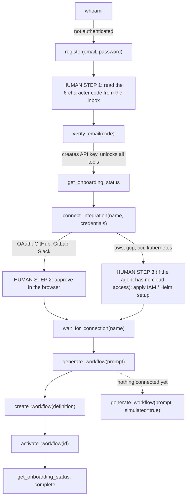

This page is written for AI coding agents (Claude Code, Cursor, Codex, OpenClaw, and similar harnesses) operating Kestrel on a user's behalf, and for the people configuring them. It is the shortest path from nothing to a running workflow, and it is explicit about the four moments where a human has to act.

If you are a human reading this, the [MCP](/workflows/mcp) and [CLI](/workflows/cli) pages cover the same ground in more depth.

## What you need

- The Kestrel CLI on the machine the agent runs on. It ships the MCP server as `kestrel mcp`.

```bash
brew install KestrelAI/tap/kestrel
```

- An MCP configuration pointing at it. **No account, API key, or login is required before the agent starts.** The server starts unauthenticated and the agent creates the account itself.

<Tabs>
  <Tab title="Claude Code">
    ```bash
    claude mcp add kestrel -- kestrel mcp
    ```
  </Tab>
  <Tab title="Cursor">
    Add to `~/.cursor/mcp.json`:
    ```json
    {
      "mcpServers": {
        "kestrel": { "command": "kestrel", "args": ["mcp"] }
      }
    }
    ```
  </Tab>
  <Tab title="Codex">
    ```bash
    codex mcp add kestrel -- kestrel mcp
    ```
  </Tab>
</Tabs>

Set `KESTREL_SERVER_URL` (or pass `--server`) only for staging or self-hosted deployments.

## The sequence



### Step 1: identify yourself

Call `whoami`. It reports the server, whether you are authenticated, and, if not, exactly which tools to call next. Every request you make is tagged with your harness name from the MCP handshake (`X-Kestrel-Client: mcp/<harness>/<version>`), so there is nothing to configure.

### Step 2: create the account (or log in)

New user: `register(email, password)`. Ask the user for their **work** email; personal domains get a smaller trial and disposable domains are rejected. Generate a strong password and tell the user what it is, or ask them for one.

<Warning>
**HUMAN STEP 1 — the verification code.** Kestrel emails a 6-character code. It only exists in the user's inbox. Ask them for it, then call `verify_email(code)`. Do not guess or retry random codes.
</Warning>

`verify_email` logs the account in, creates an API key named `mcp-<harness>` (saved to `~/.kestrel/config.json` so it survives restarts), and registers the full tool set. Your harness receives `tools/list_changed`; refresh the tool list if it does not do so automatically.

Existing user: `login(email, password)` does the same key creation. Accounts protected by 2FA or SSO cannot be logged in by a tool; the response says so and asks the user to create a key under **Settings → API Keys** and run `kestrel auth <key>`.

### Step 3: see what is left

`get_onboarding_status` returns a checklist (account, API keys, connected integrations, workflows, subscription) and one `next_recommended_step`. Call it whenever you are unsure what to do. `get_account_status` explains the trial (days left, credit used, daily execution cap) and whether anything is blocked.

### Step 4: connect integrations

`list_integrations` shows every integration, its kind, and the fields it needs. Then `connect_integration(name, credentials)`:

| Kind | What happens | Human step? |
|------|--------------|-------------|
| Token (Datadog, PagerDuty, Cloudflare, Jira, Databricks, …) | Connects immediately with the credentials you pass. Ask the user for the values; never invent them. | Only to obtain the token |
| OAuth (GitHub, GitLab, Slack) | Returns a URL. | **HUMAN STEP 2:** the user opens it and approves. Then call `wait_for_connection(name)`. |
| `aws` | Returns a CloudFormation launch URL, the equivalent `aws cloudformation create-stack` command, and an `external_id`. | **HUMAN STEP 3** unless you hold AWS credentials for the target account, in which case run the CLI command yourself. Then `connect_integration(name="aws", verify=true, credentials={role_arn, external_id})`. |
| `gcp` | Returns a Cloud Shell setup script. | **HUMAN STEP 3** unless you can run `gcloud` against the project. Then `connect_integration(name="gcp", verify=true, credentials={project_id})`. |
| `oci` | Returns setup instructions until all five credentials are supplied. | The user creates an API key in the OCI console. |
| `kubernetes` | Returns Helm values (containing the operator token) and the `helm install` command. | **HUMAN STEP 3** unless you have `kubectl`/`helm` access to the cluster. Then `wait_for_connection("kubernetes")`. |

`wait_for_connection` polls for up to 240 seconds by default (max 600) and returns the current state either way. If it comes back `connected: false`, remind the user what is pending and call it again.

### Step 5: build the first workflow

`generate_workflow(prompt)` turns plain English into a workflow definition. Review it, then `create_workflow(...)` and `activate_workflow(id)`. `test_workflow(id)` runs it with mocked inputs first if the user wants a dry run.

<Tip>
**Nothing connected yet?** Pass `simulated=true` to `generate_workflow` and `create_workflow`. The workflow is built as if every integration were connected, can be tested with mocked outputs, and is marked simulated. It cannot be activated until its integrations are actually connected. This is the right move right after signup when the user wants to see whether Kestrel can automate their case before wiring anything up.
</Tip>

If `generate_workflow` fails because an integration is not connected, the error says so and names both remedies: connect it, or retry with `simulated=true`.

## Human steps, summarized

1. **Email verification code** after `register`.
2. **Browser authorization** for GitHub, GitLab, and Slack.
3. **Cloud IAM or Helm install** for AWS, GCP, OCI, and Kubernetes, when you do not have credentials for the target environment.
4. **Billing.** Subscribing requires card entry in the browser. `get_account_status` returns the URL to hand to the user; you cannot complete checkout.

Everything else, including account creation, key management, every token integration, workflow generation, creation, testing, activation, executions, and approvals, is available to you directly.

## Errors you will see and what they mean

| Error | Meaning | Do this |
|-------|---------|---------|
| `not authenticated` | No key or session yet | `register` or `login` |
| `subscription_required: …` | Trial ended or no subscription | `get_account_status`; hand the billing URL to the user (human step 4) |
| `… is not connected …` | A block needs an integration that is not connected | `connect_integration` + `wait_for_connection`, or retry with `simulated=true` |
| `wait_for_connection` returns `connected: false` | The human step has not been completed | Remind the user; call it again |
| `… requires 2FA or SSO` | Tools cannot log this account in | The user creates an API key in the web app and runs `kestrel auth <key>` |

## From the terminal instead

Every tool has a CLI twin for agents that shell out rather than speak MCP. Set `KESTREL_AGENT=<your-name>` so Kestrel can attribute the usage.

```bash
kestrel register --create-api-key          # account + key in one go (prompts for the emailed code)
kestrel whoami
kestrel status                              # onboarding checklist + next step
kestrel account                             # trial and credits
kestrel integrations list
kestrel integrations connect github --wait  # prints the URL, polls until approved
kestrel integrations connect gcp --bootstrap --project-id my-proj
kestrel integrations connect gcp --project-id my-proj
kestrel integrations status aws
kestrel workflows generate "when a pod crash-loops in prod, run RCA and post to #oncall" --simulated --save
kestrel workflows list
kestrel workflows activate <id>
```
